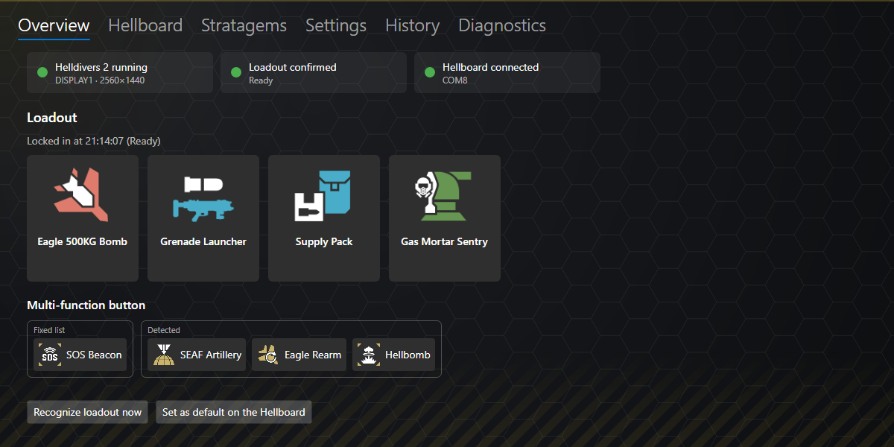

# Hellboard

This is a Macro board based on RP2040-zero and Micropython, meant for ordering Stratagems for Helldivers 2 by registering as a HID-Keyboard.

## Hellboard Companion

The Hellboard Companion is a Windows app that puts your stratagems on the Hellboard automatically. It watches the Helldivers 2 loadout screen, recognizes the four stratagems you pick and the optional mission stratagems, and sends them to the board as soon as you press *Ready*. You don't have to configure any buttons by hand. The app also configures the board and installs firmware updates, so you need nothing else to use the Hellboard.

Download it from the [releases](https://github.com/frfrh/Hellboard/releases). More details: [`Software/README.md`](Software/README.md).

### Three stratagems need a one-time setup

The game draws three stratagems differently from the icon set the Companion compares with, so they are reported as *not recognized* at first:

- **EAT-17 Expendable Anti-Tank** and **EAT-411 Leveller** – the game adds a small badge to the icon.
- **TD-220 Bastion MK XVI** – the icon set shows the Maelstrom for it. Until you set it up, a Maelstrom may also be taken for the Bastion.

Teach the Companion how they look in your game – it takes about a minute and is needed only once:

1. Put **all three** into your loadout on the loadout screen (plus any fourth stratagem) and press *Ready* (or close the screen).
2. Open the Companion and go to the **History** tab. You find one entry *Problem: stratagem not recognized* with a picture of the slot for each of them.
3. In each entry, choose the stratagem under **This is …** and click **Use as reference**.

From now on they are recognized and shown with their in-game picture. The pictures stay on your PC; the **Stratagems** tab lists them (*Only with reference*) and can remove them. The same works for any other stratagem that is not recognized, e.g. after a game update changed an icon.

## Folders

##### [Firmware](https://github.com/frfrh/Hellboard/tree/master/Firmware)

Contains the firmware to be loaded into the RP2040 and the Micropython project files.

##### [Hardware](https://github.com/frfrh/Hellboard/tree/master/Hardware)

Contains the 3D files for the case and the button caps.

##### [PCB](https://github.com/frfrh/Hellboard/tree/master/PCB)

Contains the project files for the PCB and the gerber files to order one.
Project is based on KiCad 8.0.2.

##### [Software](https://github.com/frfrh/Hellboard/tree/master/Software)

Contains the Hellboard Companion (C#/.NET, Windows): loadout recognition, transfer to the board, board configuration and firmware updates.

## Configuration

The board is configured in [`Firmware/config.json`](Firmware/config.json); the stratagems and their input codes come from [`doc/stratagems.json`](doc/stratagems.json), the single list used by the firmware and the Companion software (format: [`doc/stratagems.md`](doc/stratagems.md)).

- `fixed`, `loadout`, `multiFunction`: stratagems of the buttons `1_1`/`1_2`, row 2 and the multi-function button `1_3` (cycled with `1_4`), by their `id`.
- `modifierKey`: HID usage id of the stratagem key ([scancodes](https://deskthority.net/wiki/Scancode), e.g. 6 = `C`, 224 = left Ctrl). `modifierToggle: true` presses it once to open the menu, `false` keeps it pressed while the code is entered.
- `directionKeys`: `arrows` or `wasd`; `menuDelayMs`, `keyPressMs`, `keyReleaseMs`: wait for the stratagem menu, how long each arrow is held, pause between arrows (ms); `brightness`: LED brightness (0-255).
- `screenSaverSeconds`: display off after this time without a button press (0 = off); `scrollText`: `off`, `long` (long names scroll back and forth) or `loop` (they run continuously).

Upload the changed `config.json` to the board (see Setup). With the Hellboard Companion, all of this is set on its *Hellboard* tab instead, and the loadout is taken from the game automatically.

## Build your own

You can use the gerber files in [PCB/gerber](https://github.com/frfrh/Hellboard/tree/master/PCB/gerber) to order your own PCBs or order it directly from https://aisler.net/p/AHPZGPKK.

You will also need the following parts:

| Part | Amount | Link |
| - | - | - |
| RP2040-Zero | 1 | [link](https://www.waveshare.com/rp2040-zero.htm) |
| 0,96" OLED Display 128x64 | 1 | [link](https://de.aliexpress.com/item/1005005970901119.html) (the 26.7mm variant, blue PCB) |
| Kailh boxed switches | 8 | [link](https://www.caseking.de/ducky-kailh-box-navy-switches-mechanisch-3-pin-clicky-mx-stem-85g-110-stueck-gakc-444.html) |
| Kailh hot-swap socket | 8 | [link](https://de.aliexpress.com/item/1005006146911562.html) |
| WS2812b-2020 LED | 8 | [link](https://de.aliexpress.com/item/10000006244752.html) |
| N-Channel MOSFET[^levelshifter] | 1 |  |
| 10K 0805 resistor[^levelshifter] | 2 |  |
| M93C86-WMN6P EEPROM[^eeprom] | 1 | [link](https://www.reichelt.de/eeprom-seriell-16kb-2kx8-1kx16-2-5-5v-so-8-m93c86-wmn6p-p280935.html) |
| Button caps[^buttoncaps] | 8 | [link](https://de.aliexpress.com/item/1005003992982246.html) |

You can find icons for the buttons [here](https://github.com/nvigneux/Helldivers-2-Stratagems-icons-svg).

## Setup

1. Flash MicroPython with HID support onto the RP2040 (only needed once):
    1. Press the button (`Boot`) and connect the Board to a PC.
    2. Copy the [UF2-file](https://github.com/frfrh/Hellboard/blob/master/Firmware/libs/3rd/firmware_with_HID_support.v.1.17.uf2) into the drive `RPI-RP2`.
    3. Re-Connect the board.
2. Install the firmware files. [`Firmware/manifest.json`](Firmware/manifest.json) lists every file and its name on the board (all files go into the board's root directory, including the stratagem list [`doc/stratagems.json`](doc/stratagems.json)).
    - **With the Hellboard Companion** (`Software/`, recommended): connect the board, open the *Hellboard* tab and choose *Update Hellboard firmware*. Later updates work the same way.
    - **With the upload tool** (needs the [.NET 10 SDK](https://dotnet.microsoft.com/download/dotnet/10.0)): from the `Software` folder run `dotnet run tools/hellboard-upload/hellboard-upload.cs`. It finds the board, installs and verifies all files and restarts the board – see [`Software/tools/hellboard-upload`](Software/tools/hellboard-upload/README.md).
    - **By hand** with [Visual Studio Code](https://code.visualstudio.com/) and the [MicroPico extension](https://marketplace.visualstudio.com/items?itemName=paulober.pico-w-go): upload every file listed in the manifest under its target name (`Upload current file to Pico`).
3. Choose your stratagems in [`Firmware/config.json`](Firmware/config.json) (before uploading): buttons `1_1`/`1_2`, the loadout (row 2) and the multi-function list, referenced by their `id` in [`doc/stratagems.json`](doc/stratagems.json); `modifierKey` is the HID usage id of your stratagem key. With the Hellboard Companion (`Software/`), the loadout is set automatically from the game.

[^levelshifter]: I got them by desoldering them from a level shifter I had lying around. [link](https://de.aliexpress.com/item/1005006068381598.html)
[^eeprom]: The EEPROM is optional and currently not used: the configuration is stored in the RP2040's own flash (`config.json`).
[^buttoncaps]: I used the button caps from [here](https://de.aliexpress.com/item/1005003992982246.html) but replaced the internals with the ones from `Hardware/Kailh-Cap.stl` as the original ones are not translucent. Any button caps compatible with Kailh boxed switches should do.
