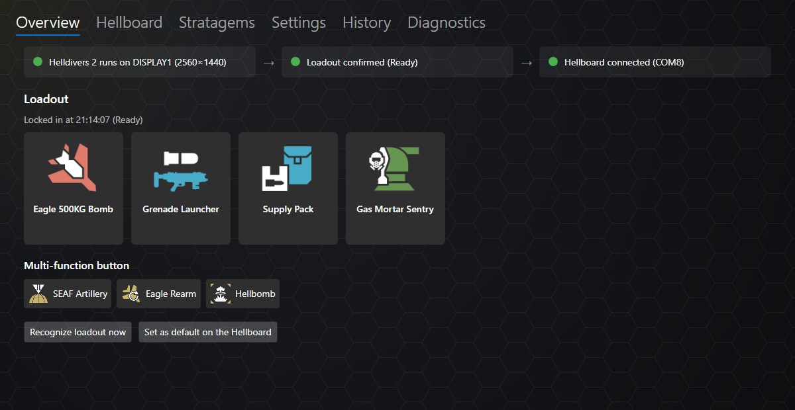
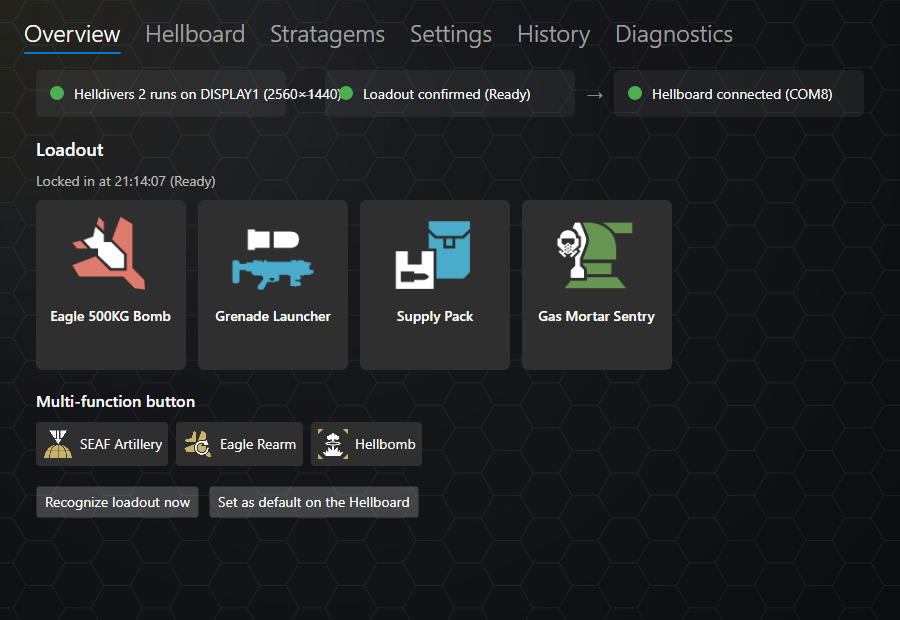
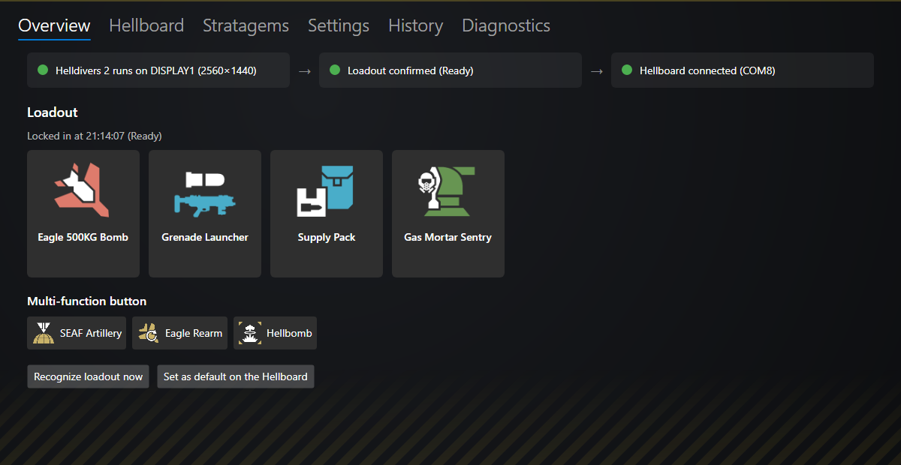
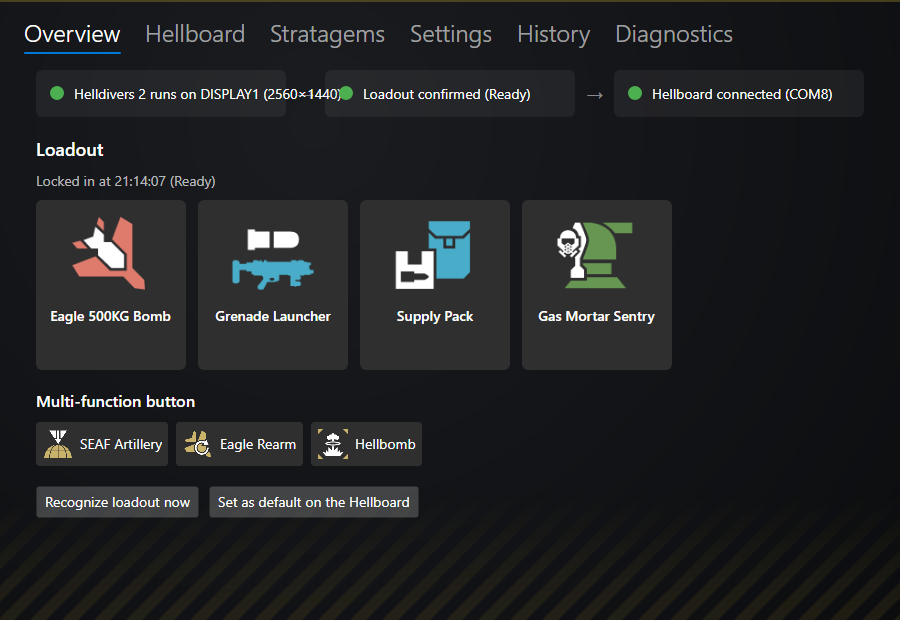
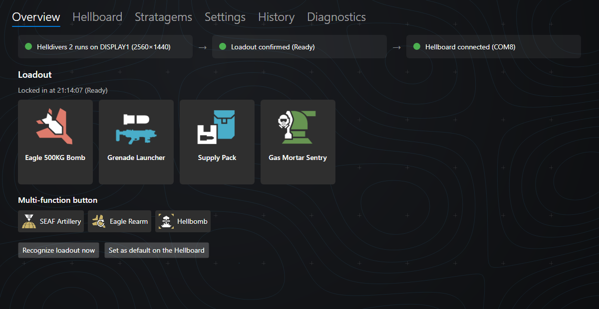
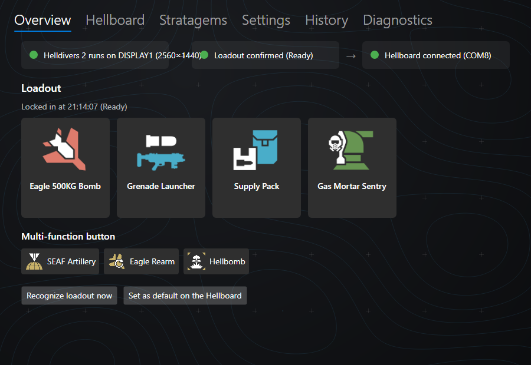
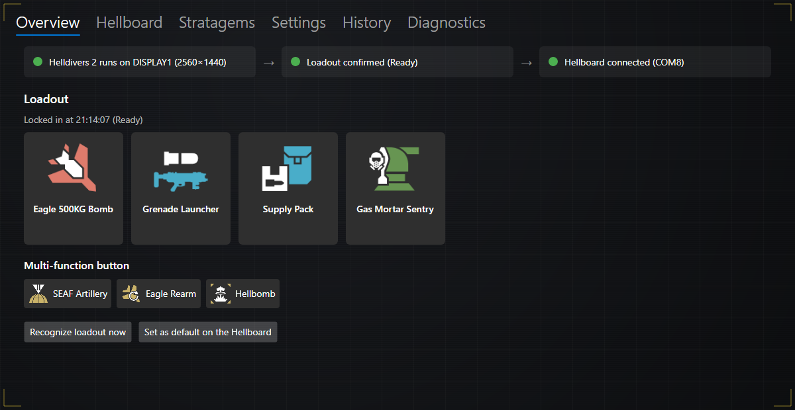
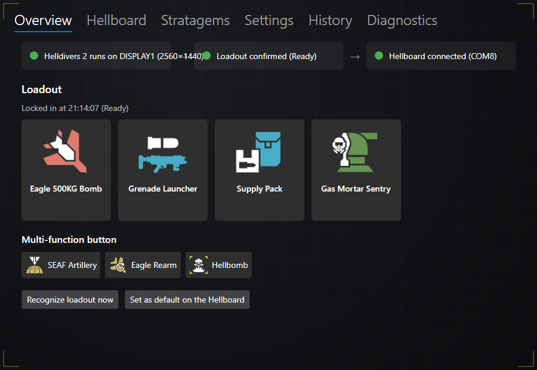

# UI polish – plan

| | |
|-|-|
| Status | **Plan, not implemented** (branch `feature/ui-polish`) |
| Date | 2026-10-17 |
| Scope | Main window of Hellboard Companion: background, status chain, multi-function list, "Recognize loadout now" |

Goal: the Companion looks more like it belongs to Helldivers 2 and stays clean at every window width. Nothing in recognition, transfer or settings changes.

## 1. Background

**Requirements:** unobtrusive and dark, but less uniform than the current flat black; in the style of Helldivers 2; no problems when the window is resized.

**How it stays correct at every size:** the background is not a stretched picture. It is drawn by the app at the current window size:

- a dark base with a soft radial gradient (vignette) that scales with the window,
- a fine pattern that is **repeated**, not scaled (tiles stay the same size, the window just shows more or less of them),
- decorations anchored to edges or corners (they move with the edges).

Technically a small `BackgroundLayer` control behind the tab control that draws on every size change (`Render` with a cached pattern tile), or Avalonia brushes (`RadialGradientBrush` + tiled `DrawingBrush`). Only own, procedurally drawn graphics – no game art. Content panels keep their own semi-transparent backgrounds, so text contrast does not change.

**Options** (real overview rendered with each background; left 1200 px wide, right at the minimum width of 900 px):

| | Option | Idea | Wide | Narrow |
|-|-|-|-|-|
| 1 | **Hex grid** | Fine hexagon grid (the hexagon of the app icon and the display logo), soft yellow glow in the top-left corner |  |  |
| 2 | **Hazard stripes** | Yellow/black warning stripes along the bottom edge, fading out upwards; thin yellow line at the top edge |  |  |
| 3 | **Tactical map** | Faint topographic contour lines in blue with map grid crosses, like the planet map / mission briefing |  |  |
| 4 | **Terminal** | Super Earth terminal: faint grid, scan lines and yellow HUD brackets in the window corners |  |  |

**Recommendation:** option 1 – it is the quietest at any size and repeats the hexagon of the icon and the display logo. Options 2 and 4 can be combined with it (hazard stripes at the bottom edge, or the corner brackets) if more Helldivers character is wanted. The narrow renders also show the problem of section 2: the status texts overlap.

The previews were rendered with the headless screenshot approach of `Software/tools/screenshot`; the final variant gets the same kind of preview for the README screenshot.

## 2. Status chain (game → recognition → Hellboard)

**Today:** a grid with three equally wide columns and two arrows. Each text sits in a horizontal `StackPanel` next to its dot; there it gets unlimited width, so `TextWrapping="Wrap"` never takes effect and a long text runs out of its field into the arrow and the next field. This already happens on a real screen at the minimum width of 900 px: "Helldivers 2 runs on DISPLAY1 (2560×1440)" needs about 320 px, a column offers about 260 px (user screenshot 2026-10-17, see also the narrow previews). Some texts are much longer – the Hellboard field can show "Hellboard connected (COM8) – firmware 2.0.0 is outdated, 2.1.1 is available on the Hellboard tab" (about 100 characters) or a free-text message from the board.

**Plan:**

- The three status entries are placed in a **`WrapPanel`**: when the window gets too narrow for all three, the last ones move to the next line; when it gets wider again, they come back. This follows every width change automatically (it is layout, no code).
- **Short text and detail line:** each entry shows a short status as its first line (always short enough for one line, never wrapped) and, if needed, a smaller, dimmer detail line below it. Only the detail line may wrap – inside its own entry, never into a neighbour. The entry grows in height, the WrapPanel moves whole entries to the next line, so an entry is never split. Entries have a maximum width (about 360 px); the full text (short text + detail) is also the tooltip of the entry.

  | Field | Short text | Detail line |
  |-|-|-|
  | Game | Helldivers 2 running | DISPLAY1 · 2560×1440 |
  | | Helldivers 2 minimized / starting … / not running | – |
  | Recognition | Loadout confirmed | Ready (or: screen closed, manual) |
  | | Loadout screen | selecting |
  | | Waiting | for the game / for the loadout screen |
  | Hellboard | Hellboard connected | COM8 |
  | | Firmware outdated | COM8 · 2.0.0 → 2.1.1, update on the Hellboard tab |
  | | Firmware not compatible | install the firmware on the Hellboard tab |
  | | Companion too old | the Hellboard firmware is newer – update Hellboard Companion |
  | | Hellboard without protocol | COM8 · message of the board |
  | | Hellboard simulator / Installing firmware … / Dry run / No Hellboard connected | – |

  The colour of the dot stays as today (good / attention / problem / inactive). The view model gets a `…Detail` property per field next to the existing text (`GameText` + `GameDetail` etc.); unit tests check the texts of every state, and that no short text is longer than about 28 characters.
- **Arrows:** a separate arrow element would end up at the end or start of a line after wrapping. Instead each entry gets a **chevron shape** (pointed right edge, notched left edge, like the Helldivers UI) – the flow direction stays visible on one line and on several lines.
- Entries have a common minimum width, so on one line they still look like a balanced row.

## 3. Multi-function button list

**Today:** one horizontal row without wrapping; the origin of an entry is not visible.

**Plan:**

- Tiles are placed in a **`WrapPanel`**: entries that do not fit move to the next line, also when the width changes; a tile never breaks inside (icon and name stay on one line).
- **Origin of the entries:** the list is shown in **groups**, each in a thin, rounded frame (1 px, low contrast) with a small caption in the top-left corner of the frame:
  - **Fixed list** – the entries of the settings,
  - **Detected** – the optional mission stratagems recognized on the loadout screen.
  
  The frame costs almost no space (a few pixels plus the caption inside the top border line). Each group is one item of an outer wrap panel; a group that does not fit next to the other one starts on a new line, and its tiles wrap inside the frame.
- The frames are shown in **every mode** (also "fixed list only" / "automatic detection only"), so the look is the same and the caption still says where the entries come from. An empty group is not shown (e.g. "Detected" before a loadout screen was seen).
- An entry that is in both (fixed and detected) appears once, in "Fixed list" – as on the Hellboard.
- Data: the overview builds the groups itself from the multi-function settings and the locked loadout (`LoadoutTransferBuilder` stays the single place that decides the order on the board; the overview only labels the groups). Unit tests for the grouping (all three modes, duplicates, empty groups).

## 4. "Recognize loadout now" only when the game is running

**Today:** the button is always shown; without the game the recognition only reports that no screen was found.

**Plan:**

- The overview button is **shown only while Helldivers 2 is running** (game status *running*, also when it is in the background or minimized – recognition needs a visible game window, but hiding the button while alt-tabbed would be irritating; it is disabled while minimized).
- The tray menu entry "Recognize loadout now" is disabled while the game is not running.
- The hotkey stays registered; pressed without the game it shows the toast "Helldivers 2 is not running" instead of an empty recognition result.
- Unchanged: *Diagnostics → Analyze image file* works without the game (testing with screenshots).

## 5. Testing

- The headless screenshot tool renders the overview at 900, 1200 and 1600 px width with long and short texts (incl. the outdated-firmware and board-message details) and 2/8/16 multi-function entries – checked visually, and kept as a script for later changes.
- Unit tests for the multi-function grouping and for the visibility of the recognize button (game states).
- Check on the user's machine: resize the window live, dark/light Windows theme (the app stays dark), high DPI (150 %).

## 6. Order and effort

| Step | Effort |
|-|-|
| Status chain with wrap panel, chevrons, short text and detail line (incl. view model and tests) | small to medium |
| Multi-function groups with frames and wrapping (incl. view model and tests) | medium |
| Recognize button / tray / hotkey depending on the game | small |
| Background (chosen option) incl. resize test | small to medium |

All in one round of work; the background last, so the layout changes can be judged on it.

## 7. Open questions for the user

1. **Background:** option 1, 2, 3 or 4 – or a combination (e.g. 1 + hazard stripes of 2)?
2. **Arrows in the status chain:** chevron-shaped entries (recommended) or no direction marks at all?
   The short texts and detail lines of section 2 are part of the plan (requested 2026-10-17); their wording can still be adjusted.
3. **Group frames** in every mode (recommended) or only with "fixed list + automatic detection"?
4. **Recognize button without the game:** hidden (as requested) – and should the hotkey without the game show a short notice (recommended) or do nothing?
